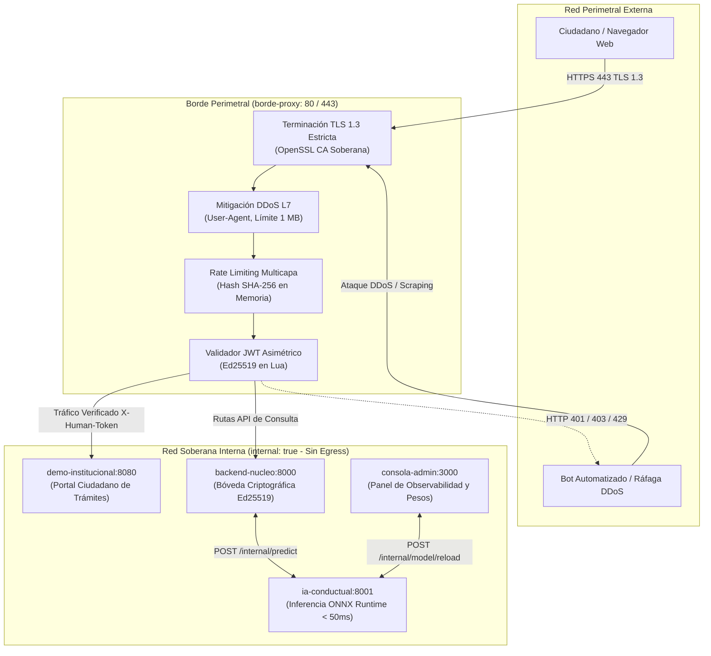

# Arquitectura Soberana, Perimetral y Aislamiento On-Premise

**Servicio Autónomo de Verificación Humana y Mitigación de Bots**  
**Hackathon Venezuela Innova 2026 — Dev 2 (IA, Borde e Infraestructura)**

---

## 1. Visión General de Soberanía Tecnológica

La plataforma está diseñada bajo el principio de **Soberanía Tecnológica Absoluta** (*Zero External Dependencies*). Opera íntegramente *on-premise* o en centros de datos nacionales aislados (*air-gapped*), garantizando que ninguna información ciudadana ni métrica biométrica sea transferida a nubes foráneas (tales como Google reCAPTCHA, Cloudflare o hCaptcha).

### Principios Rectores:
1. **Stack 100 % Código Abierto (FOSS):** Implementado con OpenResty/Nginx, LuaJIT, Python 3.11+, FastAPI y ONNX Runtime. Todos los componentes son auditables e inspeccionables.
2. **Privacidad por Diseño (*Zero Raw Biometrics / Zero Raw IPs*):** Todo análisis conductual es efímero en memoria RAM. No se persisten coordenadas crudas de puntero, pulsaciones individuales de teclado ni direcciones IP en texto claro.
3. **Seguridad en Profundidad y Aislamiento Perimetral:** El único servicio expuesto a la red pública perimetral es el proxy inverso seguro (`borde-proxy`), mientras que los motores de IA y los subsistemas de base de datos se alojan en redes internas sin salida a internet (`internal: true`).

---

## 2. Diagrama de Topología de Red y Aislamiento

---

## 3. Matriz de Segmentación de Redes (Docker / Podman)

| Red | Tipo | Acceso Externo | Servicios Conectados | Propósito |
| :--- | :---: | :---: | :--- | :--- |
| **`perimetral`** | Bridge | Sí (Puertos 80/443) | `borde-proxy` | Punto único de contacto público con cifrado forzoso TLS 1.3. |
| **`soberana_interna`** | Bridge (`internal: true`) | **NO (Aislada)** | `borde-proxy`, `ia-conductual`, `demo-institucional`, `backend-nucleo`, `consola-admin` | Comunicación inter-servicios de alta velocidad sin enrutamiento ni salida a internet. |

---

## 4. Ciclo de Vida de una Petición en el Borde

1. **Recepción TLS 1.3:** La conexión se establece exclusivamente sobre `TLSv1.3` con certificados emitidos por la CA Soberana local, garantizando secreto perfecto hacia adelante (*PFS*).
2. **Inspección L7 Rápida:** En la fase `access_by_lua` de OpenResty, se valida:
   - Presencia y validez de la cabecera `User-Agent` (bloqueo HTTP 403 si falta).
   - Longitud máxima del cuerpo $\le 1\text{ MB}$ (bloqueo HTTP 413 si excede).
3. **Lista Negra y Rate Limiting:**
   - La IP se anonimiza en memoria compartida mediante $\text{SHA-1}(\text{IP} + \text{sal\_local})$ para evitar el almacenamiento de identificadores reales.
   - Si la ruta es `/login`, se aplica un tope estricto de $10\text{ req/min}$; ante ráfagas, el proxy devuelve inmediatamente `HTTP 429` con cabecera `Retry-After: 60`.
4. **Verificación Criptográfica de Token:**
   - Si la ruta está protegida y el sistema opera en modo `challenge` o `block`, se exige `X-Human-Token` o cookie `vh_token`.
   - Si falta: emisión de `HTTP 401` con código estandarizado `VERIFICATION_REQUIRED`.
   - Si está presente: validación local en Lua de expiración (`exp`) y firma criptográfica sin consultar al backend en cada petición.
5. **Proxy Transparente:** La petición legítima verificada fluye hacia `demo-institucional:8080` inyectando la cabecera `X-Verified-Human: true`.
