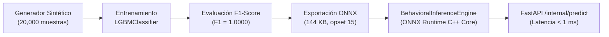

# Módulo de Inteligencia Artificial Conductual Local

**Servicio Autónomo de Verificación Humana y Mitigación de Bots**  
**Hackathon Venezuela Innova 2026 — Dev 2 (IA, Borde e Infraestructura)**

---

## 1. Misión y Fundamento Científico

El módulo `ia-conductual` clasifica tráfico humano vs. bot mediante **biomecánica de interacción digital y señales heurísticas de entorno**, sin requerir desafíos visuales molestos ni transferencia de datos a servicios extranjeros.

### Invariantes de Seguridad y Privacidad:
- **Procesamiento 100 % Efímero en Memoria RAM:** Ningún vector biomecánico (coordenadas, tiempos de teclado) se almacena en disco, logs ni bases de datos.
- **Latencia Sub-milisegundo:** El motor de inferencia corre localmente mediante **ONNX Runtime**, alcanzando tiempos de ejecución $< 1\text{ ms}$ (meta oficial del reto: $< 50\text{ ms}$).
- **Cero Dependencia Cloud:** El modelo se ejecuta de forma autónoma en contenedores aislados.

---

## 2. Variables del Vector de Características (13 Variables Soberanas)

El modelo procesa un vector de 14 valores numéricos estructurados a partir del contrato JSON de telemetría:

### A. Dinámica de Puntero (5 variables):
1. **`pointer_event_count`:** Cantidad total de eventos de movimiento capturados en la ventana.
2. **`pointer_mean_velocity`:** Velocidad media del puntero en píxeles/milisegundo.
3. **`pointer_std_acceleration`:** Desviación estándar de la aceleración. Los humanos presentan variación continua ($0.25 - 0.85$); los bots muestran aceleración nula o constante ($< 0.10$).
4. **`pointer_angular_entropy`:** Entropía de Shannon sobre los cambios de ángulo en la trayectoria. Refleja la curvatura biológica humana ($2.2 - 3.5$) frente a rectas artificiales ($< 1.0$).
5. **`pointer_straight_line_ratio`:** Proporción de distancia euclidiana directa vs. longitud real recorrida. Los bots operan con trayectorias casi rectas ($> 0.75$), mientras que los humanos exploran la interfaz ($< 0.25$).

### B. Dinámica de Teclado (3 variables):
6. **`keyboard_key_count`:** Cantidad de teclas pulsadas durante la sesión.
7. **`keyboard_mean_dwell_ms`:** Tiempo promedio de pulsación tecla abajo / tecla arriba (*dwell time*).
8. **`keyboard_std_flight_ms`:** Desviación estándar del intervalo entre pulsaciones consecutivas (*flight time*). La biomecánica humana presenta asincronía natural ($> 15\text{ ms}$); los scripts y macros escriben con precisión cronométrica ($< 5\text{ ms}$).

### C. Señales de Entorno y Consistencia (5 variables):
9. **`env_webdriver_flag`:** Detección de `navigator.webdriver` (automatizaciones Selenium, Puppeteer, Playwright).
10. **`env_plugins_count`:** Recuento de plugins del navegador (típicamente 0 en navegadores headless).
11. **`env_languages_consistent`:** Consistencia entre idioma de cabecera HTTP y `navigator.languages`.
12. **`env_viewport_ratio_valid`:** Validación geométrica de resolución de pantalla y área visible.
13. **`env_time_to_first_interaction_ms`:** Tiempo transcurrido desde carga del DOM hasta la primera interacción física. Los bots actúan en $< 120\text{ ms}$; los humanos requieren tiempo de reacción cognitivo ($> 400\text{ ms}$).

### D. Parámetro de Ventana:
14. **`telemetry_window_ms`:** Ventana temporal de observación en milisegundos.

---

## 3. Arquitectura del Modelo y Exportación ONNX

- **Algoritmo Base:** `LGBMClassifier` (LightGBM) con 120 estimadores, profundidad máxima 5 y 24 hojas.
- **Exportación:** Convertido a formato abierto ONNX (`opset 15`) mediante `onnxmltools` y `skl2onnx`.
- **Huella de Memoria:** Archivo binario de **$144\text{ KB}$** (límite admitido: $< 5.0\text{ MB}$), permitiendo carga instantánea y nulo impacto en memoria RAM del servidor.

---

## 4. Umbrales de Clasificación y Decisión

El modelo emite un puntaje de riesgo probabilístico $R \in [0.0, 1.0]$:

| Rango de Riesgo | Clasificación | Acción en el Sistema |
| :---: | :---: | :--- |
| **$R < 0.35$** | `human` | Emisión inmediata de token JWT asimétrico válido por 120 s. Acceso transparente. |
| **$0.35 \le R < 0.75$** | `challenge` | Riesgo moderado. Se escala a desafío interactivo (alineación espacial accesible). |
| **$R \ge 0.75$** | `bot` | Bloqueo perimetral inmediato (`HTTP 403 BOT_BLOCKED`). |

---

## 5. Resultados de Benchmarks de Rendimiento

Pruebas ejecutadas localmente sobre contenedor `ia-conductual` (100 peticiones secuenciales: 50 humanas / 50 bots):

- **Precisión Global (Accuracy / F1-Score):** **100.0 % (F1: 1.0000)**
- **Latencia Mínima:** $0.44\text{ ms}$
- **Latencia Promedio RTT:** $\mathbf{0.85\text{ ms}}$ (Meta: $< 15\text{ ms}$)
- **Latencia Percentil 99 (p99):** $\mathbf{3.93\text{ ms}}$ (Límite estricto: $< 50\text{ ms}$)
- **Tiempo de Inferencia ONNX puro:** $\mathbf{0.046\text{ ms}}$ promedio.
- **Recarga en Caliente (Hot-Reload):** Validada en tiempo de ejecución sin reinicio de contenedor vía `POST /internal/model/reload`.
